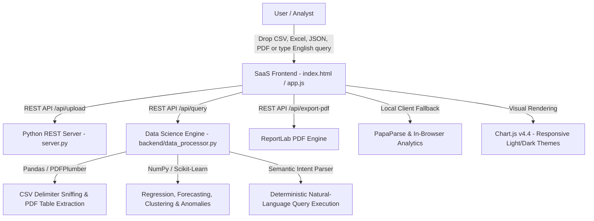

# ⚡ NeuroData AI — Enterprise Data Analytics & Predictive Visualization Studio

> An intelligent, full-stack AI data analytics and predictive visualization platform engineered with modern HTML5, Vanilla CSS (Enterprise SaaS Design System), Python REST backend (Pandas, Scikit-Learn, PDFPlumber, ReportLab), and natural-language query processing.

---

## 🌟 Executive Overview

**NeuroData AI** bridges the gap between raw datasets and actionable business intelligence. Users can either upload raw files or type normal English business questions (such as *"Show me the most purchased product"*, *"Calculate total sales and average order value"*, or *"Predict next month's sales"*) to receive computed metrics, interactive visualizations, and plain-English strategic takeaways.

### Key Capabilities
- **Multi-Format Ingestion**: Full support for `.csv` (auto-delimiter and encoding sniffing), `.xlsx`/`.xls` (multi-sheet selector), `.json`, and `.pdf` (automated table extraction via `pdfplumber` and selectable table inspector).
- **Natural-Language Commands ("Ask NeuroData AI")**: Deterministic intent parser mapping business semantics to dataset columns with dynamic Chart.js rendering and evidence data tables.
- **Automated Exploratory Data Analysis (EDA)**: Automatic 5-number statistical summaries, skewness, variance, Tukey outlier detection, categorical distributions, and interactive Pearson correlation heatmaps.
- **Intelligent Business Insights**: Structured takeaways complete with supporting metric, business implication, and actionable recommendations.
- **Predictive AI Suite**: Linear and Quadratic (Degree 2) OLS Regression with real-time "What-If" prediction, Holt's Exponential Trend Forecasting with horizon selection, K-Means Clustering, and Tukey/Z-score Anomaly Scanners.
- **Data Transformation & Hygiene**: Deduplication, missing value imputation (Mean, Median, Mode, Constant, or Drop), and one-click **Undo / Restore Original Dataset**.
- **Publication-Grade Reporting**: Generates formal Executive Dossier PDF reports directly via ReportLab as well as print-optimized CSS.

---

## 🚀 Quick Start (How to Run)

### 1. Requirements & Dependencies
Ensure Python 3.10+ is installed on your system. Install dependencies:
```bash
pip install -r requirements.txt
```

### 2. Method 1: One-Click Windows Launcher (Recommended)
Simply double-click the included batch launcher:
```cmd
run_app.bat
```
This launches the multi-threaded Python server and opens your default browser at `http://localhost:8000`.

### 3. Method 2: Python Command Line
```powershell
python server.py
```
Then visit [http://localhost:8000](http://localhost:8000) in any modern browser.

---

## 🏛️ System Architecture



---

## 📡 REST API Specifications

The Python backend exposes a modular REST API on port 8000:

| Endpoint | Method | Description |
|---|---|---|
| `/api/health` | `GET` | Returns server health status, Python version, and loaded libraries (`pandas`, `openpyxl`, `pdfplumber`, `pypdf`, `scikit_learn`, `reportlab`). |
| `/api/upload` | `POST` | Multipart file ingestion supporting `.csv`, `.xlsx`, `.xls`, `.json`, `.pdf`. Returns unified schema, records, null counts, and table/sheet metadata. |
| `/api/query` | `POST` | Natural-language analytics processor. Accepts `{ query, records }` and returns computed summaries, evidence tables, and Chart.js configurations. |
| `/api/eda` | `POST` | Computes full descriptive statistics, Tukey outlier bounds, and Pearson correlation matrices. |
| `/api/predict` | `POST` | Runs predictive modeling (`regression`, `forecast`, `clustering`, `anomaly`) and returns metrics ($R^2$, RMSE, MSE, MAE). |
| `/api/export-pdf` | `POST` | Generates a binary publication-grade Executive Dossier PDF via ReportLab. |

---

## 🧪 Testing & Verification

A dedicated automated test suite is included in `tests/test_api.py`. To run all unit and integration tests:

```powershell
python tests/test_api.py
```

### Verified Test Cases:
1. `GET /api/health`: Confirmed all data science and PDF libraries are operational.
2. `POST /api/upload` (CSV): Parsed 50 rows, 9 columns with delimiter auto-detection.
3. `POST /api/upload` (Excel): Parsed multi-sheet workbook (`sample_products.xlsx`).
4. `POST /api/upload` (PDF): Extracted tabular data from `sample_tables.pdf` with intact column headers.
5. `POST /api/query`: Computed real aggregations for *"Show me the most purchased product"* and *"Calculate total sales and average order value"*.
6. `POST /api/export-pdf`: Successfully generated and downloaded a binary PDF dossier.

---

## 📁 Repository Structure

```
site/
├── backend/
│   └── data_processor.py    # Core data processing, PDF extraction, NLP queries & ML
├── css/
│   └── style.css            # Enterprise SaaS design system (Light default, Dark mode)
├── js/
│   ├── vendor/              # Bundled Chart.js and PapaParse for 100% offline reliability
│   │   ├── chart.umd.min.js
│   │   └── papaparse.min.js
│   ├── app.js               # Central coordinator & reactive state manager
│   ├── datasets.js          # Curated industry & academic benchmark datasets
│   ├── eda.js               # Statistical profiler & data cleaning utilities
│   ├── ml.js                # Client-side predictive algorithms (Regression, K-Means, Holt)
│   ├── visualizer.js        # Chart.js theme controller with high-res PNG export
│   └── reports.js           # Automated business insights & dossier generator
├── test_data/               # Sample CSV, Excel, and PDF datasets for instant testing
│   ├── sample_sales.csv
│   ├── sample_products.xlsx
│   ├── sample_tables.pdf
│   └── sample_messy.csv
├── tests/
│   └── test_api.py          # Automated REST API integration test suite
├── index.html               # Main enterprise SaaS dashboard interface
├── server.py                # Multi-threaded Python HTTP/REST API server
├── requirements.txt         # Documented Python dependencies
├── run_app.bat              # One-click Windows application launcher
└── README.md                # Comprehensive architecture & user guide
```

---

## 🛡️ Security & Privacy Notice

- All calculations occur locally on your machine. No sensitive corporate or academic datasets are uploaded to third-party cloud servers.
- Safe predefined deterministic analytical operations prevent arbitrary code execution from user natural-language input.
